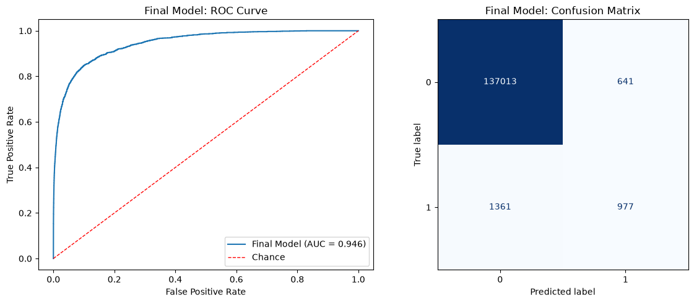
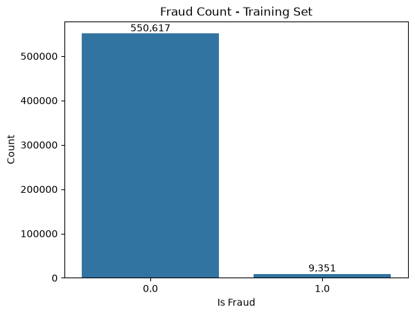
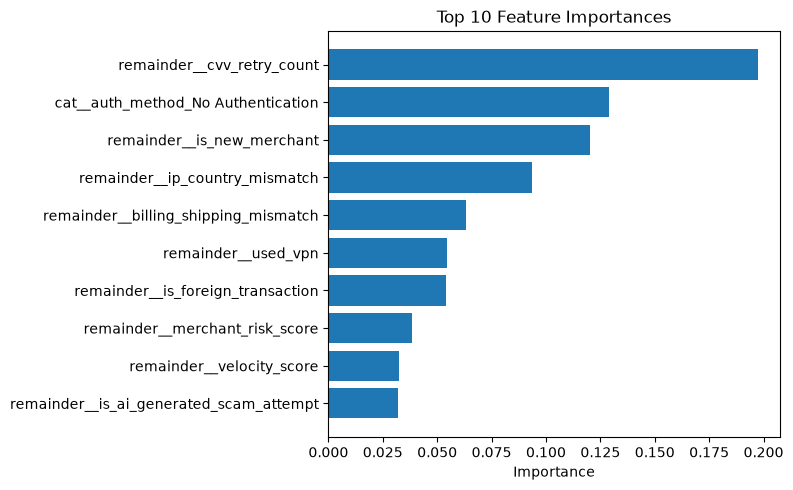

# Predicting Credit Card Fraud

A binary classification model that flags fraudulent credit card transactions, built for the Kaggle [Playground Series S6E11](https://www.kaggle.com/competitions/playground-series-s6e11) competition. The work compares a linear baseline with two gradient-boosted tree models, tunes the best one with Optuna, and produces a probability for every transaction in the test set.

**Final model:** tuned XGBoost: **0.9456 ROC-AUC** on a held-out dev set (0.9472 mean in 5-fold CV during tuning).



## The Problem

Fraud is rare. Only **1.67%** of training transactions are fraudulent (9,351 of 559,968 in the training split), so accuracy is a poor measure: a model that predicts "not fraud" every time is 98% accurate and finds nothing. The competition is scored on **ROC-AUC**, which measures how well the model ranks fraudulent transactions above legitimate ones, and the notebook evaluates every model on that metric.



## Data

| Split | Rows | Columns |
|---|---|---|
| Train | 699,960 | 24 features + `is_fraud` |
| Test | 299,984 | 24 features |

The dataset is synthetic, with no missing values. Features fall into four groups:

- **Transaction:** `amount_usd`, `time_of_day_hour`, `day_of_week`, `channel`, `merchant_category`, `is_new_merchant`, `is_foreign_transaction`
- **Behavioral / velocity:** `hours_since_last_txn`, `txn_count_last_24h`, `velocity_score`, `distance_from_home_km`, `cvv_retry_count`
- **Account / customer:** `card_age_months`, `customer_age`, `account_balance_usd`, `prior_disputes`, `card_type`
- **Risk signals:** `auth_method`, `device_type`, `merchant_risk_score`, `used_vpn`, `ip_country_mismatch`, `billing_shipping_mismatch`, `is_ai_generated_scam_attempt`

## Approach

The full workflow is in [`notebooks/01_predicting_credit_card_fraud.ipynb`](notebooks/01_predicting_credit_card_fraud.ipynb).

1. **Validation split.** 80/20 stratified train/dev split, so both sets keep the 1.67% fraud rate. All EDA uses only the training portion to avoid leaking dev-set information.
2. **Exploratory analysis.** Target distribution, a pairplot of numeric features on a 5,000-row sample, and fraud rates by category.
3. **Preprocessing.** A scikit-learn `Pipeline` with a `ColumnTransformer` that one-hot encodes the five categorical columns and passes numeric and boolean columns through. Logistic regression adds a `StandardScaler`, and the tree models skip it.
4. **Model comparison.** Each candidate is fit on the training split and scored on the dev split with ROC-AUC, a classification report, a ROC curve and a confusion matrix.
5. **Cross-validation.** 5-fold stratified CV on the best model to check that its dev score holds up.
6. **Hyperparameter tuning.** Optuna search over XGBoost's tree depth, learning rate, regularization, sampling and `scale_pos_weight` (class-imbalance weighting), with 5-fold CV ROC-AUC as the objective.
7. **Submission.** The tuned pipeline predicts fraud probabilities for the test set, saved as a timestamped CSV in `submissions/`.

## Results

### Model comparison (dev set)

| Model | ROC-AUC | Fraud precision | Fraud recall | Fit time |
|---|---|---|---|---|
| Logistic Regression (balanced) | 0.9401 | 0.11 | 0.85 | 1.2s |
| LightGBM | 0.9418 | 0.73 | 0.30 | 12.8s |
| XGBoost | 0.9427 | 0.73 | 0.32 | 9.5s |
| **XGBoost (tuned)** | **0.9456** | 0.60 | 0.42 | 10.0s |

Precision and recall are measured at the default 0.5 threshold. ROC-AUC does not depend on the threshold.

Untuned XGBoost scored **0.9442 ± 0.0019** ROC-AUC in 5-fold CV, close to its dev score, so the dev split is a reliable guide. The best Optuna trial reached **0.9472** CV ROC-AUC with shallow trees (`max_depth=3`), a moderate learning rate (~0.044), ~1,300 estimators and `scale_pos_weight≈2.3`.

### What drives the predictions



The strongest signals are the ones a fraud analyst would expect:

- **`cvv_retry_count`** is by far the most important feature. Repeated CVV attempts suggest someone guessing card details.
- **No authentication** stands out in EDA as well: these transactions are fraudulent ~6% of the time, compared with ≤1% for PIN, OTP, 3D Secure or biometric authentication.
- **New merchants, IP/country mismatches, billing/shipping mismatches, VPN use and foreign transactions** make up most of the rest of the top 10.
- **Merchant category** matters too. Gift cards (7%), crypto exchanges (6%) and gaming (6%) have much higher fraud rates than groceries or utilities (1%). Card type, channel and device type have flat fraud rates (~2% everywhere) and carry little signal.

### Takeaways

- The three model families are within 0.003 ROC-AUC of each other before tuning, so a few strong features carry most of the signal.
- Class weighting changes where the errors land. Balanced logistic regression catches 85% of fraud but flags many legitimate transactions. The untuned tree models do the opposite. Tuning `scale_pos_weight` gave the final model a better balance: recall rose from 0.32 to 0.42 while keeping 0.60 precision.
- In practice, the decision threshold would be set from the business cost of a missed fraud versus a declined legitimate purchase. The model's ranking quality (ROC-AUC) is what makes that choice possible.

## Project Structure

```
.
├── data/                 # Competition data (git-ignored, downloaded by the notebook)
├── images/               # Figures exported from the notebook for this README
├── notebooks/
│   └── 01_predicting_credit_card_fraud.ipynb
├── submissions/          # Timestamped Kaggle submission files
├── pyproject.toml        # Dependencies (managed with uv)
└── uv.lock
```

## Reproducing the Results

Requirements: Python 3.14, [uv](https://docs.astral.sh/uv/), and a Kaggle account with [API credentials](https://www.kaggle.com/docs/api) configured. You must also accept the competition rules on Kaggle before the data can be downloaded.

```bash
git clone <repo-url>
cd playground-series-s6e11
uv sync
uv run jupyter lab notebooks/01_predicting_credit_card_fraud.ipynb
```

Run the notebook top to bottom. It downloads the data into `data/` with `kagglehub` and writes a submission file to `submissions/`. A fixed `RANDOM_STATE` makes the splits and models reproducible. Optuna's search is not seeded, so tuned results may vary slightly between runs.

## Next Steps

- Run a longer Optuna search (the current study uses 10 trials) with a seeded sampler, and add early stopping.
- Retrain the final model on the full training set (train + dev) before predicting the test set.
- Try CatBoost with native categorical handling, and blend the boosted models.
- Engineer interaction features from the strongest signals (e.g., CVV retries × no authentication, amount relative to account balance).
- Set a decision threshold from an explicit cost of false positives versus false negatives, and report precision-recall AUC alongside ROC-AUC.

## Tech Stack

Python · pandas · NumPy · scikit-learn · XGBoost · LightGBM · Optuna · seaborn / matplotlib · kagglehub · uv
